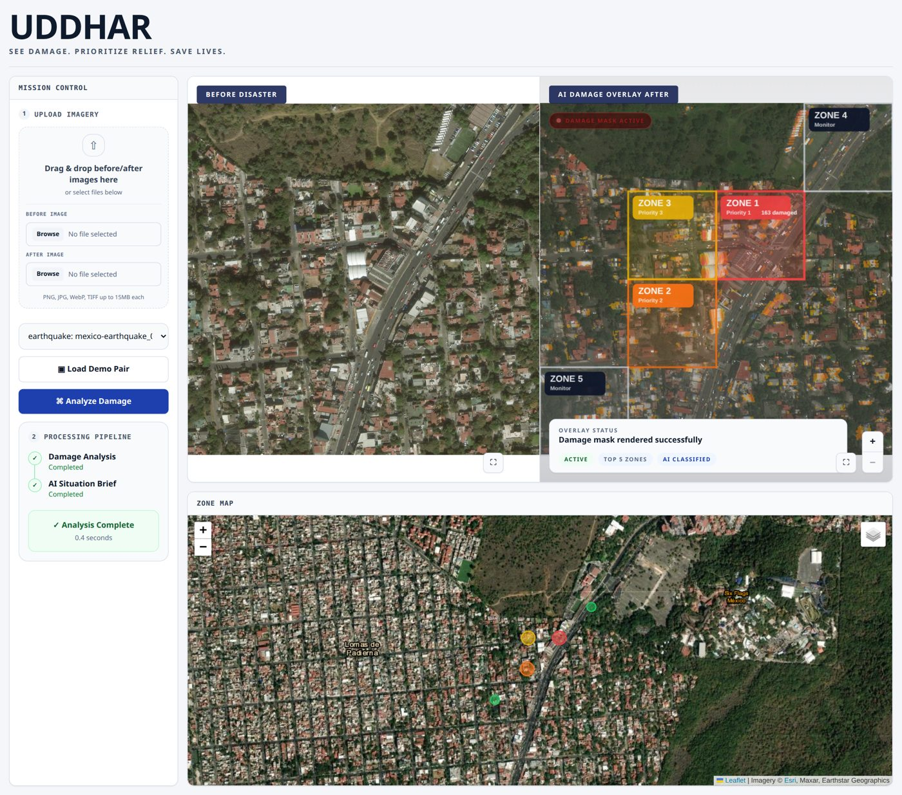

# UDDHAR

**See damage. Prioritize relief. Save lives.**

UDDHAR compares a before and an after satellite image of the same place, marks the damage, and ranks the area into priority zones so relief teams know where to go first. Project 1 (Computer Vision), Team Yukti.

## Dashboard

<p align="center">
  
</p>

<p align="center"><em>Before image, damage overlay with the top five priority zones, and the zones placed on a real map.</em></p>

---

## How to Use It

1. Start the app on your machine (see [Run It Locally](#run-it-locally-setup-guide) below) and open http://localhost:3000.
2. In the **Mission Control** panel, pick a demo pair and click **Load Demo Pair**, or upload your own before and after images (PNG, JPG, WebP or TIFF, up to 15 MB each).
3. Click **Analyze Damage**.
4. Read the results:
   - the **damage overlay** on the after image (yellow = minor, orange = major, red = destroyed),
   - the **top five priority zones**, labelled on the overlay,
   - the **zone map**, which places the zones on real satellite tiles when the pair has location data (the four xBD demo pairs),
   - the **processing pipeline** panel, which shows when the analysis and the situation brief have finished and how long the analysis took.

> The backend can also write a Gemini situation brief (`/brief`) and a PDF field report (`/report/pdf`). Both are available through the API at http://localhost:8000/docs; the current dashboard does not display the brief text or offer a PDF button.

---

## Run It Locally (Setup Guide)

UDDHAR has two parts that run side by side:

| Part | Technology | Address |
|---|---|---|
| **Backend** (image analysis API) | Python, FastAPI | http://localhost:8000 |
| **Frontend** (dashboard) | Next.js, TypeScript | http://localhost:3000 |

There are three ways to run it. Pick one:

| Option | Use it when | Damage model |
|---|---|---|
| [**A. Backend + frontend directly**](#option-a-run-backend-and-frontend-directly) | Normal development and demos | Classical change detection (`stub`, fast) |
| [**B. Docker Compose**](#option-b-run-everything-with-docker-compose) | You only have Docker and don't want to install Python or Node | Classical change detection (`stub`, fast) |
| [**C. Pretrained deep learning model**](#option-c-run-with-the-pretrained-deep-learning-model) | You want real deep learning results in the dashboard | Official xView2 model (`docker`, slow) |

### Prerequisites

| Tool | Version | Needed for | Check with |
|---|---|---|---|
| Git | any recent | All options | `git --version` |
| Python | **3.12** (the pinned packages are built for it) | A, C | `python3 --version` |
| Node.js + npm | **20 or newer** | A, C | `node --version` |
| Docker Engine or Docker Desktop | 24 or newer, with Compose v2 | B, C | `docker compose version` |
| Disk space | about 2 GB (A), 5 GB (B), 10 GB (C) | | |

Optional: a **Google Gemini API key** for the AI-written situation brief. Without it the app still works and uses a built-in template brief.

### 1. Clone the repository

```bash
git clone https://github.com/lamafuri/Project-1---CV-Sunway-.git
cd Project-1---CV-Sunway-
```

Seven demo image pairs are included in `data/demo/`, so nothing else needs to be downloaded.

### 2. Create the environment file

The backend reads its settings from a `.env` file in the **repository root**. Copy the template:

```bash
cp .env.example .env            # Linux / macOS
copy .env.example .env          # Windows (Command Prompt or PowerShell)
```

Every setting has a working default, so you can leave `.env` unchanged for a first run. The variables are:

| Variable | Default | What it does |
|---|---|---|
| `INFERENCE_MODE` | `stub` | Damage model: `stub` (classical change detection), `docker` (pretrained xView2 model, see Option C) or `pytorch` (fine-tuned checkpoint, none ships with the repo) |
| `GEMINI_API_KEYS` | empty | One or more Gemini API keys, comma-separated, for the situation brief. Empty = template brief |
| `GEMINI_MODEL` | `gemini-3.6-flash` | Gemini model tried first |
| `GEMINI_FALLBACK_MODELS` | `gemini-2.5-flash,gemini-2.0-flash` | Models tried in order when the first one is out of quota |
| `DEMO_DATA_DIR` | `data/demo` | Folder with the demo pairs. Relative paths are resolved from the repository root |
| `XVIEW2_DOCKER_IMAGE` | `darknem-xview2-inference` | Image name used when `INFERENCE_MODE=docker` |
| `PYTORCH_CHECKPOINT_PATH` | `ml/checkpoints/damage_best.ckpt` | Checkpoint used when `INFERENCE_MODE=pytorch` |
| `CORS_ORIGINS` | localhost:3000 and the Vercel site | JSON list of frontend addresses allowed to call the API, e.g. `["http://localhost:3000"]` |
| `CORS_ORIGIN_REGEX` | empty | Optional regex of extra allowed origins. Leave empty unless you need it |
| `ACCESS_TOKEN` | empty | If set, the analysis endpoints require an `X-API-Key` header with this value |
| `RATE_LIMIT_REQUESTS` / `RATE_LIMIT_WINDOW_SECONDS` | `60` / `60` | Requests allowed per IP per window. `0` turns rate limiting off |
| `DISABLE_OPENAPI_DOCS` | `false` | `true` hides the API docs at `/docs` |
| `KEEP_ALIVE` | `true` | Only matters on Render hosting, where the backend pings itself to stay awake. Does nothing locally |

The frontend has one variable of its own, `NEXT_PUBLIC_API_URL`, the backend address. It defaults to `http://localhost:8000`, so you only need it if the backend runs somewhere else. Put it in `frontend/.env.local`:

```bash
NEXT_PUBLIC_API_URL=http://localhost:8000
```

> Never commit `.env` or `.env.local`. Both are already git-ignored.

### Option A: Run backend and frontend directly

Use two terminals, both starting from the repository root.

**Terminal 1: backend**

Linux / macOS:

```bash
python3.12 -m venv backend/.venv
source backend/.venv/bin/activate
pip install -r backend/requirements-dev.txt
uvicorn app.main:app --app-dir backend --reload --port 8000
```

Windows (PowerShell):

```powershell
py -3.12 -m venv backend\.venv
backend\.venv\Scripts\Activate.ps1
pip install -r backend\requirements-dev.txt
uvicorn app.main:app --app-dir backend --reload --port 8000
```

On Windows you can also run `.\scripts\start-backend.ps1`, which creates the virtual environment on first use and then starts the server.

Wait for `Uvicorn running on http://127.0.0.1:8000`. Next time you only need the activate line and the `uvicorn` line.

**Terminal 2: frontend**

```bash
cd frontend
npm ci          # first time only
npm run dev
```

Open **http://localhost:3000**, pick a demo pair, click **Load Demo Pair**, then **Analyze Damage**.

### Option B: Run everything with Docker Compose

From the repository root:

```bash
docker compose up --build
```

The first build takes a few minutes. When both containers are running, open **http://localhost:3000**. Press `Ctrl+C` to stop, and run `docker compose down` to remove the containers.

Compose reads `INFERENCE_MODE` and the Gemini settings from the same `.env` file. Keep `INFERENCE_MODE=stub` for this option: the pretrained model cannot run from inside the backend container (see Option C), so `docker` mode fails here.

### Option C: Run with the pretrained deep learning model

This mode sends each image pair to the official **xView2 baseline**, a deep learning model already trained on the xBD dataset. It finds buildings and grades their damage, so the dashboard can show undamaged buildings and ignores changes on trees, water and roads. No training is needed.

1. **Build the model image** (once per machine, 15 to 30 minutes, a few GB of downloads):

   ```bash
   docker compose --profile build-ml build ml
   ```

   On Linux, if you get `permission denied` from Docker, add yourself to the `docker` group, then log out and back in:

   ```bash
   sudo usermod -aG docker $USER
   ```

2. **Switch the backend to this model.** In `.env` set:

   ```bash
   INFERENCE_MODE=docker
   ```

3. **Start the backend and frontend as in Option A.** The backend must run directly on your machine (not through `docker compose up`), because it starts the model container itself.

Each analysis takes about 30 to 60 seconds (measured at 29 to 40 seconds per 1024 × 1024 pair on a 16-core desktop CPU), because the model's TensorFlow 1.15 runs on the CPU only. Set `INFERENCE_MODE=stub` again to go back to the fast mode.

#### Precomputed results

The pretrained model's output for all seven demo pairs is saved in [`data/demo/pretrained_results/`](data/demo/pretrained_results/), so you can look at it without building anything:

- `<pair>_mask.png`: the raw damage mask (pixel values 0 to 4)
- `<pair>_overlay.jpg`: the mask drawn in colour over the post-disaster image
- `summary.json`: zone scores for every pair, and accuracy against the xBD ground truth for the four labelled pairs, compared with the classical model

To regenerate them after building the image, with the backend's Python environment active:

```bash
python scripts/precompute_pretrained.py
```


---

## The Problem

When disasters strike, response teams need fast answers:

- Where is the damage most severe?
- Which zones should rescue teams inspect first?
- How many structures appear damaged or destroyed?
- Where should limited relief resources be sent immediately?

Traditional damage assessment often depends on manual ground surveys, which can be slow, dangerous, and incomplete, especially after floods, earthquakes, wildfires, hurricanes, and other large-scale disasters.

**UDDHAR is built to reduce that delay.**

---

## What UDDHAR Does

UDDHAR is an AI-powered disaster triage dashboard that analyzes before-and-after imagery and converts it into clear emergency-response insights.

It can:

- Compare pre-disaster and post-disaster imagery
- Detect visible damage patterns
- Classify damage severity across affected zones
- Display a visual damage overlay
- Generate damage summaries
- Rank priority response zones
- Produce an AI-assisted situation brief
- Export a field-ready disaster damage report

---

## Built for Global Disaster Response

UDDHAR is not limited to one country or one disaster type.

It is designed for global disaster scenarios where before-and-after imagery is available, including:

- Floods
- Earthquakes
- Wildfires
- Hurricanes
- Landslides
- Severe storms

Example deployment scenarios include Pakistan floods, Venezuela earthquakes, Turkey/Syria earthquakes, wildfire damage assessments, hurricane-hit coastal regions, and other international disaster-response operations.

---

## Key Features

### Before / After Image Analysis

Upload or load paired imagery from before and after a disaster event.

### Visual Damage Overlay

Damage results are displayed directly over the affected area, making it easier to understand the scale and location of destruction.

### Damage Summary

The dashboard summarizes affected structures and damage severity in a clear visual format.

### Priority Zone Ranking

UDDHAR ranks zones based on severity, helping emergency teams decide where to respond first.

### Situation Brief

The system generates a concise emergency-response brief that explains the damage pattern and recommended next steps.

### Field Report Export

Users can export a structured disaster damage report for response teams, coordinators, and stakeholders.

---

## Damage Severity Levels

| Severity | Description |
|---|---|
| No Damage | Area or structure appears largely unaffected |
| Minor Damage | Light visible damage or limited disruption |
| Major Damage | Significant visible damage requiring urgent inspection |
| Destroyed | Severe destruction or likely structural collapse |

---

## Demo Workflow

```text
Load or Upload Disaster Image Pair
              ↓
View Before / After Comparison
              ↓
Run Damage Analysis
              ↓
Display Damage Overlay
              ↓
Generate Damage Summary
              ↓
Rank Priority Zones
              ↓
Create Situation Brief
              ↓
Export Field Damage Report
```

---

## Technology Stack

### Frontend

- Next.js
- TypeScript
- Tailwind CSS
- Interactive disaster dashboard
- Visual damage summary and zone ranking

### Backend

- Python
- FastAPI
- Image processing pipeline
- REST API
- Report generation

---

## Dataset & Fine-Tuning

UDDHAR builds on the open **xView2 / xBD building-damage dataset**, paired
pre- and post-disaster satellite imagery with per-building damage labels.

### Getting the data

The full dataset is large (train and test archives are ~10 GB each), so it is
**not stored in this repository** (it is git-ignored). Download it directly from
the official source:

- **Official dataset:** [xview2.org](https://xview2.org), free registration required
- The download provides the pre/post image pairs plus labels and target masks

This repo already ships **seven demo pairs** (`data/demo/images/`) so the app
runs end-to-end out of the box, no download needed: three river-valley flood
scenes, plus four curated xBD pairs that carry matching labels and
ground-truth target masks.

### Curate demo pairs from the full dataset

After downloading and extracting the test archive to `data/test/`:

```powershell
.\scripts\curate_demo_subset.ps1
```

This copies the pairs listed in `data/demo/manifest.json` into `data/demo/`.

### Inference modes

The backend picks its damage model from `INFERENCE_MODE` in `.env`:

| Mode | What it runs | Per-zone confidence |
|---|---|---|
| `stub` | A pre/post pixel-difference heuristic: co-registration, illumination matching, percentile thresholding, connected-component filtering | No |
| `docker` | The official xView2 TF 1.15 baseline, in a container | No |
| `pytorch` | A fine-tuned checkpoint (`ml/checkpoints/damage_best.ckpt`) | Yes |

Only `pytorch` produces class probabilities, so `confidence` is reported for
that mode alone. See [`ml/README.md`](ml/README.md) for details.

**The hosted demo runs `stub`, and it is a heuristic, not a learned model.**
Every input goes through it: the shipped demo pairs and a stranger's upload
alike. The xBD ground-truth masks in `data/demo/targets/` are used only for offline
evaluation and to rank the pairs the manifest does not order; they are never served as model
output. An earlier build did short-circuit to them for demo pairs, which made
the demo look far better than the system was, and that path has been removed.

A consequence worth knowing before you read the dashboard: the heuristic detects
*change*, so it cannot label an undamaged building (class 1). "No Damage" reads
0 in `stub` mode by construction. Distinguishing an intact building from bare
ground needs the trained model.

`docker` mode requires building the baseline image first:

```powershell
docker compose --profile build-ml build ml
```

The first `docker`-mode analysis is slow (~2 min: TF 1.15 cold start plus two
models), so `stub` remains the default for a responsive live demo.

### Fine-tuning

Fine-tuning runs on a **PyTorch** fork of xView2, not the TF 1.15 baseline.
TensorFlow 1.15 has no practical ROCm build. Extract the train archive, filter
to the target hazard types with `scripts/prepare_train_subset.py`, then:

```bash
bash ml/finetune/run_amd_notebook.sh   # AMD Instinct / ROCm notebook
bash ml/finetune/run_amd_pipeline.sh   # AMD Instinct / ROCm over SSH
bash ml/finetune/run_kaggle_pipeline.sh  # CUDA fallback
```

The notebook script also captures the AMD hardware evidence described in
[`docs/AMD_COMPUTE.md`](docs/AMD_COMPUTE.md). Full runbook in
[`ml/finetune/README.md`](ml/finetune/README.md).

**Status: not executed.** We could not get working hackathon GPU access, so no
checkpoint ships and `pytorch` mode is untested end-to-end.

---

## Development

```powershell
# Backend tests
cd backend; .\.venv\Scripts\python.exe -m pytest tests/ -v

# ML inference tests (CPU only: no GPU or checkpoint needed)
python -m pytest ml/pytorch-inference/tests/ -v

# Frontend
cd frontend; npm run typecheck; npm run lint; npm run build
```

CI runs all of the above on every push and pull request
(see [`.github/workflows/ci.yml`](.github/workflows/ci.yml)).

---

## Use Cases

UDDHAR can support:

- Emergency response coordination
- Building damage assessment
- Humanitarian relief planning
- Satellite imagery analysis
- Disaster zone prioritization
- Rapid field reporting
- Government and NGO response planning

---

